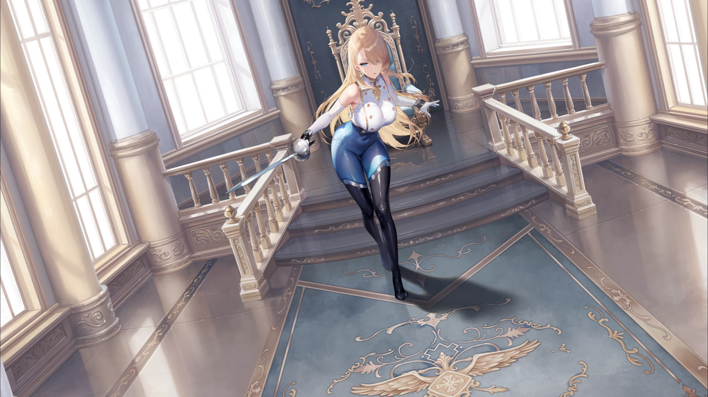

# 技能壁纸设计方案：Wilhelmina「Iron_Monarch」

> 素材：`spine\skill_cutscene\Wilhelmina\Iron_Monarch\cutscene_char067601`（ID 067601）
> 技术栈：React 18 + Vite 5 + spine-webgl 4.1.56 + wallkit
> 设计日期：2026-11-13



上图是把 spine 与 2048² 背景实际渲染合成出的画面（1920×1080，`loop_2` 待机帧），不是游戏截图。

## 1. 为什么选它

从 171 套 cutscene 里筛选时，Angelica「The_Fallen」是第一个候选；换成 Wilhelmina 这套后，三条硬指标都更优：

| 指标 | 066401 The_Fallen | **067601 Iron_Monarch** |
|---|---|---|
| 待机姿势 | `B_cut_idle` 站立，但背景是废墟、偏暗 | **`loop_2` 站姿持剑，正对王座** |
| 背景 | 1024² 需放大到 2048²（会糊） | **2048² 原生，画面直接可用** |
| 图集 | 1 页 2048×1024 | 2 页 2048² |
| 背景与人物关系 | 冷暖对比但透视对不上 | 台阶/地毯/王座三级纵深，人物脚踩在地毯中轴上 |
| 动画 | 6 条，`ALL` 不可打断 | 4 条，`cut_B` 与 `loop_2` 天然衔接 |

关键优点：**`loop_2` 是站姿循环，`cut_B` 是同一姿势的演出段**——两者 bounds 几乎一致（宽 2326 / 2329，高 2002 / 2018），切换时人物不位移、不跳帧。这在 cutscene 素材里很少见。

## 2. 素材规格（实测）

| 项 | 值 |
|---|---|
| 骨骼 / slot / region | 534 / 165 / 168 |
| 图集 | 2 页 2048×2048（`cutscene_char067601.png` + `_2.png`） |
| 纹理占用 | **33.5MB** VRAM（2 × 16MB；背景走 CSS 不占） |
| 源体积 | skel 1.20MB + png 6.04MB = **7.24MB**（仓库 `model-library/` 版；F 盘原始 PNG 为 7.96MB） |
| WebP q90 后 | 图集 1.22MB + 背景 0.42MB，skel 不打折 → **约 2.84MB 传输** |
| 世界包围盒（`loop_2`） | `{ x: -988, y: -1551, w: 2326, h: 2002 }`，竖长比 0.86 |
| 背景 | `char067601_back1.png` **2048²**，王座厅，alpha 均值 254（完全不透明） |
| 备用背景 | `char067601_back2.png` 1024²，仰视天花板，配 `cut_A` / `loop` 那条线 |

### 动画清单

| 动画 | 时长 | 姿势 | 用途 |
|---|---|---|---|
| `cut_A` | 3.43s | 背身弯腰（整理头发） | ❌ 与本方案的站姿线冲突，不用 |
| `cut_B` | 3.33s | **站姿持剑**，手臂/披风微动 | 点击演出 |
| `loop_2` | 4.00s | **站姿持剑**，呼吸循环 | ✅ 主待机 |
| `loop` | 8.00s | 背身弯腰 | 可选彩蛋（默认关） |

`loop` 和 `loop_2` 是**两套姿势各自的循环**，不是长短版本——游戏里对应两个不同状态。所以不能"长短交替"来避机械感，只能用 `loop_2` 单条循环。

## 3. 技术栈与依赖

```
React 18 + JSX（无 TypeScript，沿用 wallkit 约定）
Vite 5 + @vitejs/plugin-react
@esotericsoftware/spine-webgl@4.1.56   ← 必须是 4.1 线
wallkit（git 引用，锁 commit）
```

```json
{
  "dependencies": {
    "@esotericsoftware/spine-webgl": "4.1.56",
    "react": "^18.3.1",
    "react-dom": "^18.3.1",
    "wallkit": "github:mikoberry/wallkit#<commit>"
  }
}
```

## 4. 分层与目录

```
┌─────────────────────────────────────────────────┐
│ 控件层  <Clock/> <Spectrum/>            wallkit  │  ← git 引用
├─────────────────────────────────────────────────┤
│ 外壳层  WE 注入 / project.json / 部署   本仓库   │
├─────────────────────────────────────────────────┤
│ 背景层  Backdrop（背景图） + SpineStage  本仓库   │
└─────────────────────────────────────────────────┘
```

目录结构见 [AGENTS.md](../AGENTS.md) §3。

## 5. 舞台与坐标系

```js
// src/stage/stageConfig.js
export const MODEL = {
  dir: 'models/wilhelmina/',
  name: 'cutscene_char067601',
  idleBounds: { x: -988, y: -1551, w: 2326, h: 2002 },  // loop_2 全程并集
}

export const FRAMING = {
  figureHeight: 0.90,   // 人物高度 ÷ 视口高
  anchorX: 0.45,        // 人物 bounds 中心 ÷ 视口宽（0.5 = 正中，0.45 = 略偏左）
  anchorY: 1.00,        // 人物脚底 ÷ 视口高
}

export const BACKDROP = {
  src: 'models/wilhelmina/back1.webp',
  fit: 'cover',
  dim: 0.94,            // 背景本来就偏亮，只轻压
  vignette: 0.22,
  grain: 0.02,
}
```

**缩放的坑**：`spine-webgl` 的 `Camera.zoom` 与"每世界单位多少像素"成**反比**（zoom 越大画面越小）。实测 `pad` 是乘在 `max(boundsW/视口W, boundsH/视口H)` 上的，所以实现时写成：

```js
const fit = Math.max(bounds.w / viewport.w, bounds.h / viewport.h)
camera.zoom = fit * pad          // pad 越大人物越小
// 由 figureHeight 反解 pad：pad = (bounds.h / (viewport.h * figureHeight)) / fit
```

**为什么人物偏左**：王座在背景正中，人物居中会把王座完全挡住。`anchorX: 0.45` 让人物左移 5% 屏宽，王座右侧的靠背与扶梯就露出来了，同时右上角留出控件区。

**背景走 CSS `` + `object-fit: cover`，不进 WebGL**：静态图不占纹理单元、不参与 rAF。代价是背景按视口 cover、人物按 figureHeight 缩放，两条缩放曲线不联动——刻意的，壁纸要"人物够大"，不是复现游戏分镜。

**俯视 vs 平视**：背景是俯视广角，人物是正面平视，脚部透视会有轻微错位。这是游戏分镜的固有属性（游戏里人物贴满屏，不需要对位），不要试图用缩放到"修好"它——拉得越准，人物越小，反而更假。当前 0.90 的 figureHeight 是"人物足够大 + 错位不明显"的折中。

## 6. 动画编排

```
boot ──300ms──▶ idle (loop_2 4s 循环)
                    │
        ┌───────────┴────────────┐
        │ 点击 / 每 90s           │ 空闲 > 5min 且开启彩蛋
        ▼                        ▼
   perform (cut_B 3.33s)     ambient (loop 8s 背身)
        │                        │
        └───────▶ idle ◀─────────┘
```

| 状态 | 动画 | 说明 |
|---|---|---|
| `idle` | `loop_2` | 唯一常驻状态，4s 循环 |
| `perform` | `cut_B` | 与 `loop_2` 同姿势，播完直接回 `loop_2`，无需过渡 |
| `ambient` | `loop` | 背身弯腰，**默认关闭**（WE 属性开关） |

接口（`choreography.js`，纯函数）：

```js
export const STATES = { idle: 'idle', perform: 'perform', ambient: 'ambient' }
export function next(state, event) → { state, anim, loop }
// 事件：'loaded' | 'finished' | 'click' | 'idleLong' | 'wake'
```

**淡入淡出**：`idle ⇄ perform` 用 `setMix(0.2)`（同姿势，快切即可）；进出 `ambient` 用 `0.8`（姿势差异大，慢混否则像鬼畜）。

**已知缺陷（必须知道）**：`cut_B` 和 `loop_2` 的动作差异很小——主要是手臂位置与披风摆动。点击后的"演出"观众几乎看不出来。这是素材本身的限制，不是实现问题。两个可选增强：

1. 点击时不换动画，而是给舞台加一次**镜头推近**（`figureHeight` 0.90 → 0.96，600ms 缓动）配合 `cut_B`，视觉变化才够；
2. 或者把 `ambient`（`loop` 背身）绑到点击上，变化最明显，但姿势是背对的，取决于是否接受。

默认按方案 1 做。

## 7. 控件编排（wallkit）

```
┌──────────────────────────────────────────┐
│                              ╭─────────╮ │  Clock ring，右上，offset 5%/6%
│                              │  21:47  │ │  theme="dark"（浅色背景 → 深色字）
│         Wilhelmina           │  周五    │ │
│         （偏左）              ╰─────────╯ │
│                                          │
│  ▁▃▅▂▇▃▁▅▂                               │
│  ━━━━━━━━━━━━━━━━━━━━━━━                  │
└──────────────────────────────────────────┘  Spectrum bottom-left
```

**配色反过来了**：Angelica 那套是暗背景配浅色字，这套是**浅色亮调场景**，所以：

```jsx
<Clock
  now={now}
  placement="ring"
  theme="dark"             // 深色文字，用于浅色壁纸
  anchor="top-right"
  offsetX={5} offsetY={6}
  beat={beat}
  tilt={{ maxTilt: 5, speed: 8 }}
/>

<Spectrum
  bars={bars}
  variant="curve"
  colorHex="#8a7042"       // 深金，取自地毯纹章
  anchor="bottom-left"
  offsetX={5} offsetY={4}
  size={84}
  paused={paused}
/>
```

`--wallkit-accent: #8a7042`（深金）。备选 `#4a6b8a`（制服的钢蓝）。

## 8. WE 集成

```js
// vite.config.js
import { defineConfig } from 'vite'
import react from '@vitejs/plugin-react'
import { wallkitWE } from 'wallkit/we/vite'

export default defineConfig({
  plugins: [react(), wallkitWE({ audio: true, media: false, pause: true })],
  base: './',   // WE 里是本地文件，必须相对路径
})
```

`project.json` 的 `title` 改为 `BrownDust 2 — Wilhelmina Iron_Monarch`，属性沿用上版结构，只改默认值：

| 属性 | 默认 | 说明 |
|---|---|---|
| `clockstyle` | `ring` | ring / card / minimal / none |
| `spectrumstyle` | `curve` | curve / bars / none |
| `parallax` | 60 | 鼠标视差强度 |
| `autoPerform` | 90 | 自动演出间隔（秒），0 = 关 |
| `dim` | 94 | 背景压暗（这套背景本来就亮，压到 82 会发灰） |
| `ambientPose` | `false` | 新增：空闲切 `loop` 背身姿势 |

## 9. 交互

| 交互 | 实现 | 风险 |
|---|---|---|
| 鼠标视差 | `pointermove` → 归一化 −1…1 → camera 偏移 ±1.2% 视口宽，指数阻尼 6/s | 低 |
| 点击演出 | `click` → `perform` + 镜头推近 | **中**，WE 可能吞点击，需实测 |
| 音频响应 | `useWallpaperAudio()` → `extractSpectrumBars`；`useWallpaperBeat()` → Clock 缩放 | 低 |
| 暂停 | `useWallpaperPaused()` + `visibilitychange` → 停 rAF | 低 |

视差只改 `camera.position`，不触碰骨骼。

## 10. 资产流水线

**素材主源在仓库内**：`model-library/Iron_Monarch/`（skel / atlas / 2 页 png，与游戏源文件 atlas+skel 逐字节一致；PNG 经过 PSNR 38–39dB 的轻量有损压缩，壁纸画质下不可辨，无需回退 F 盘原始版本）。

`scripts/prepare-model.mjs`：

1. 从 `model-library/Iron_Monarch/` 读 4 个文件（skel / atlas / 2 页 png）。
2. 背景从 **`F:\live2d\BrownDust2\model-output\chibis\Wilhelmina\Iron_Monarch\char067601_back1.png`**（2048²）读——注意它不在 `ui/skill_cutscene_background/` 里，且**不在** `model-library/` 中（需要的话手动补进去）。
3. PNG → WebP q90（sharp，缺则 ffmpeg）。
4. **改 atlas 两处页名**：`cutscene_char067601.png` → `.webp`、`cutscene_char067601_2.png` → `_2.webp`。只改页名行，`bounds` / `offsets` 不动。
5. 背景 2048² **原样**转 WebP，不放大。
6. 输出 `public/models/wilhelmina/`。

**背景来源特殊**：这套 cutscene 的配对背景不在 `ui/skill_cutscene_background/`，而是混在 `chibis/Wilhelmina/Iron_Monarch/` 里，四个文件：`back1`(2048²)、`back1move`(1024²)、`back2`(1024²)、`back2move`(1024²)。只有 `back1` 是 2048² 且与站姿线匹配；`*move` 变体是同场景的 1024² 版本，不要用。

## 11. 性能与功耗

| 项 | 值 |
|---|---|
| 纹理 | 2 页 2048² = **33.5MB** VRAM（背景走 CSS 不占） |
| 骨骼 / region | 534 / 165，单次 `drawSkeleton` |
| 传输 | ≈ 2.84MB |
| 目标帧率 | 60fps；`prefers-reduced-motion` 降到 30fps |
| 暂停 | 取消 rAF，纹理保留不释放 |

比 Angelica 那套重 4 倍（33.5MB vs 8MB），但仍远低于 interaction 的 224MB。挂机可接受。

## 12. 风险

| 风险 | 影响 | 对策 |
|---|---|---|
| `cut_B` 与 `loop_2` 动作差异极小 | 点击演出"看不出来" | 加镜头推近补偿（§6） |
| `loop` 背身姿势与站姿差异巨大 | 切过去像换了个场景 | 默认关闭，开关暴露给用户，混合时长 0.8s |
| 背景俯视、人物平视 | 脚部透视轻微错位 | 接受；figureHeight 0.90 是折中值 |
| 2 页图集 = 33.5MB | 弱显卡/双屏挂机会吃显存 | 可后续裁掉未使用的 region 合成 1 页 |
| WE 吞点击 | 少一个交互 | 保留自动演出兜底 |
| Spine Runtimes License | 公开发布受限 | 自用无碍；分发需保留许可声明 |
| 背景在 `chibis` 目录 | 流水线路径反直觉 | 已在 §10 写死并注明 |

## 13. 待确认

1. **背景压暗 0.94** 是按"王座厅本来就亮、压多了发灰"定的，实际看你桌面亮度。
2. **时钟位置**：右上 `ring` 会压在右上柱廊上（浅色，深字可读）。也可放左上窗户区。
3. **要不要 `ambientPose` 彩蛋**（空闲 5 分钟后切背身 `loop`）？我默认关，因为姿势跳变大。
4. **点击演出**：先按"镜头推近 + `cut_B`"做，还是先验证 WE 是否支持点击？
